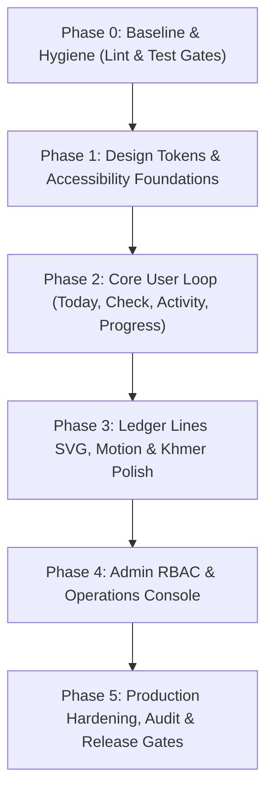

# BrokeNoMore Implementation Waves & Release Plan

This document defines the sequenced roadmap for implementing the BrokeNoMore 2.0 UX/UI improvements. Each wave builds on the previous one, maintaining a green build and passing test gates at every step.

---

## Wave Summary & Rollout Strategy

---

## Phase 0: Evidence & Hygiene (Immediate Pre-requisites)
- **Objective:** Fix pipeline failures and establish clean build baselines before adding features.
- **Tasks:**
  - `UX-001`: Fix React Compiler / hook errors in `review-step.tsx`, `check-panel.tsx`, and `use-mobile.ts`. Escape JSX entities.
  - Add explicit `"typecheck": "tsc --noEmit"` script to `package.json`.
- **Release Gate:** `bun run lint && bun test && bun run build` all pass with 0 errors.
- **Rollback Strategy:** Revert individual component hook edits.

---

## Phase 1: Foundations & Design System
- **Objective:** Establish the Obsidian Ledger token system and accessibility baseline across themes.
- **Tasks:**
  - `UX-004`: Complete OKLCH palette definitions for both `.dark` (Obsidian) and `.light` (Parchment) in `globals.css`.
  - `UX-005`: Ensure minimum 44px touch targets on all interactive triggers and standard 2px visible focus rings.
  - `UX-006`: Add localized dynamic `<title>` metadata generation to all route layouts.
- **Release Gate:** axe-core accessibility score of 100 on common components; WCAG 2.2 AA contrast verified in both themes.
- **Rollback Strategy:** Token changes are scoped to CSS variables.

---

## Phase 2: Core User Loop (PWA 4-Destination Shell)
- **Objective:** Implement the full mobile-first information architecture mandated by the PRD.
- **Tasks:**
  - `UX-002`: Scaffold missing `/[locale]/progress` route and update `app-shell.tsx` bottom bar to the 4-tab model (Today, Plan, Activity, Progress) + center Check action.
  - `UX-003`: Complete localization bindings in `today-view.tsx`, `check-panel.tsx`, and `review-step.tsx`.
  - `UX-009`: Add skeleton loading states (`loading.tsx`) and offline detection banner.
- **Release Gate:** User can navigate between all 4 tabs and trigger Purchase Check without errors or layout shifts in mobile viewports (320px, 390px).
- **Rollback Strategy:** Feature branch isolate; bottom navigation can toggle between legacy 5-item and 4-item layouts.

---

## Phase 3: Progress, SVG & Motion Polish
- **Objective:** Elevate visual quality and delight with bespoke Ledger Lines illustrations and purposeful motion.
- **Tasks:**
  - `UX-010`: Implement lightweight Ledger Lines SVGs for empty activity, empty waitlist, and Sunday Sweep milestone.
  - Integrate Motion for React micro-interactions with strict `prefers-reduced-motion` fallbacks.
  - Implement Khmer typography line-height adjustments to prevent glyph clipping.
- **Release Gate:** Zero layout jank (CLS < 0.1); bundle size increase < 30KB; reduced motion mode renders instant transitions.
- **Rollback Strategy:** SVGs can fallback to standard Lucide icons; motion wrappers can be bypassed.

---

## Phase 4: Admin Architecture & Operations Console
- **Objective:** Implement database-enforced administrative security and the staff operations console.
- **Tasks:**
  - `UX-007`: Apply Supabase migration `20261017000000_admin_rbac.sql` with staff roles and RLS policies.
  - `UX-008`: Scaffold Admin Console Shell (`/[locale]/admin`) and build the Section 1 Attention Queue.
  - Build privacy-preserving user support search (no default balance exposure).
- **Release Gate:** Supabase RLS tests confirm non-staff users cannot query admin tables; staff users can access attention queue and operational logs.
- **Rollback Strategy:** Admin routes live in an isolated route group; migration can be safely reverted or disabled without affecting user tables.

---

## Phase 5: Production Hardening & Release
- **Objective:** Final end-to-end verification and compliance sign-off.
- **Tasks:**
  - Cross-browser testing at 320px, 390px, 768px, 1024px, and 1440px.
  - 200% zoom reflow verification.
  - Final audit of integer arithmetic across edge case currency amounts.
- **Release Gate:** Full test suite passes: `bun test`, `bun run lint`, `bun run build`, E2E smoke tests. Zero P0/P1 defects remaining.
